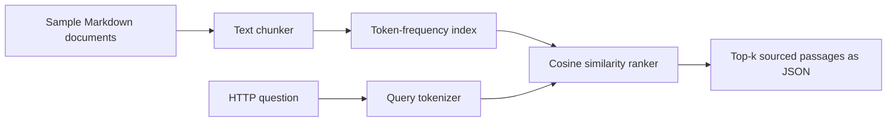

# Retrieval architecture

## Implemented
The service creates a local index at startup and returns source filenames and retrieved chunks. It uses lexical TF-IDF-like ranking in memory. No third-party API keys are needed.

## Proposed enterprise RAG architecture (not implemented)
Document ingestion to object storage -> parsing and PII filtering -> embeddings -> vector database -> hybrid retrieval/reranking -> LLM prompt with citations -> response validation and evaluation. Production needs authentication, tenancy boundaries, injection defenses, observability and access control at document level.

## Limitations
This is **not yet generative RAG**. Search performance has not been benchmarked on an external labeled dataset. Query rewriting and embedding similarity are future work.
